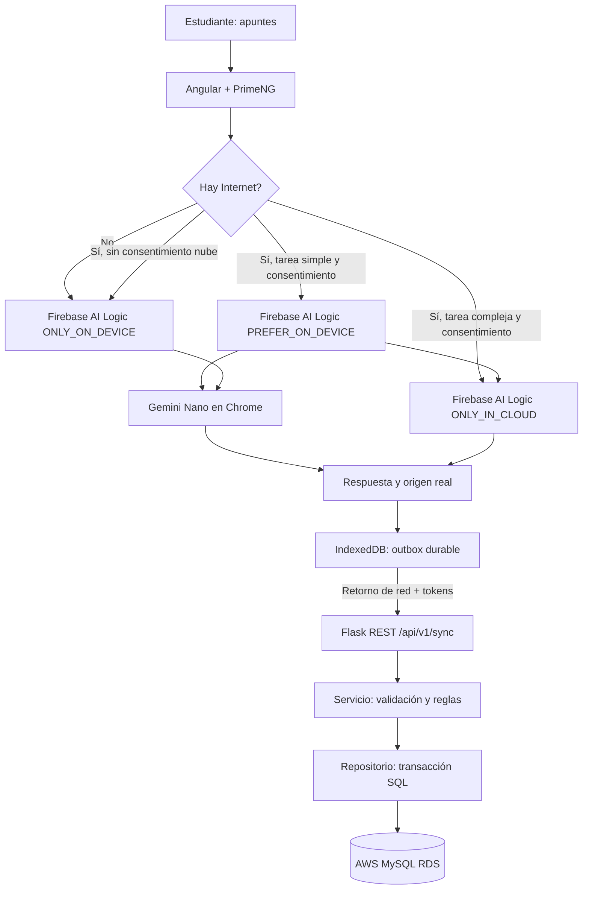

# ADR-001: Inferencia híbrida Edge/Cloud con persistencia desacoplada

| Campo | Valor |
|---|---|
| Estado | Aceptado para MVP; sujeto a validación de rendimiento y privacidad |
| Fecha | 2026-11-16 |
| Proyecto | OstrixAi / #BuildHybridAI 2026 |
| Decisores | Equipo de desarrollo OstrixAi |
| Alcance | Web (Angular + PrimeNG), Firebase AI Logic, AWS Flask, MySQL |

## 1. Contexto y problema

OstrixAi ofrece un tutor educativo en entornos donde la conectividad puede fallar.
La aplicación debe **seguir resolviendo tareas textuales compatibles con un modelo local ya
instalado**, mantener los apuntes disponibles, usar razonamiento en nube con consentimiento
cuando aporte valor y conservar de forma confiable el historial para varios dispositivos.

Condicionantes:

- Gemini Nano web depende de Chrome Desktop, compatibilidad del sistema y recursos físicos,
  más una **descarga inicial en línea**. No se presupone que está disponible en todos los equipos.
- Firebase AI Logic Web SDK v12.5+ expone `InferenceMode.PREFER_ON_DEVICE`,
  `ONLY_ON_DEVICE`, `PREFER_IN_CLOUD` y `ONLY_IN_CLOUD`. Este proyecto integra la API
  real `firebase/ai` y reporta `response.inferenceSource`.
- App Check es obligatorio para Firebase AI Logic. No sustituye autenticar al estudiante
  ni protege automáticamente la API propia desplegada en AWS.
- Offline-first significa que la app puede abrirse tras un primer uso conectado (PWA/Service
  Worker), la cola persiste en IndexedDB y las consultas locales funcionan si Gemini Nano
  ya está disponible; **no garantiza inferencia offline en cualquier navegador o equipo**.

## 2. Decisión

Se acepta una arquitectura **cliente híbrido con dos planos separados**:

1. **Plano de inferencia — Firebase AI Logic desde Angular:** Chrome/Gemini Nano para
   resúmenes y tareas locales; Gemini Cloud por Firebase AI Logic para consultas complejas,
   solicitudes consentidas cuando falla la inferencia local o usuarios sin modelo local.
2. **Plano de persistencia — AWS:** la API Flask `POST /api/v1/sync` recibe eventos
   posteriores a la inferencia, comprueba Firebase App Check y Firebase Authentication,
   valida en un servicio de dominio y realiza un `INSERT` parametrizado en MySQL.
3. **Plano de resiliencia — navegador:** IndexedDB almacena eventos pendientes en una cola
   durable. Cada evento posee un UUIDv4; MySQL usa clave primaria `(user_uid, event_id)`.
   El servidor puede recibir la misma carga otra vez sin duplicarla. Solo se borran de la
   cola los identificadores expresamente confirmados.

> El diagrama representa bifurcaciones de política. Cuando la red falla, el SDK configurado
> como `ONLY_ON_DEVICE` no puede recurrir silenciosamente a la nube. Si el modelo local no
> funciona, el usuario recibe un error real y los apuntes introducidos permanecen en el editor.

## 3. Motivación: latencia, privacidad y costo

| Criterio | Dispositivo / Edge | Nube / Firebase AI Logic |
|---|---|---|
| Latencia | Evita trayecto WAN cuando el modelo ya está preparado; la velocidad depende del hardware | Añade red y cola, con capacidad de modelos más grandes |
| Privacidad | El texto para inferencia no sale del navegador; la posterior sincronización sí transmite la información que el usuario decide guardar | El prompt viaja al servicio externo. Requiere consentimiento claro, política de retención y minimización |
| Costos | Sin cobro de inferencia del servidor para esa consulta; consume CPU/RAM/energía del usuario | Puede generar cuotas, límites y costos según el modelo y plan; no garantizar gratuidad ilimitada |
| Disponibilidad | Requiere modelo previamente descargado y dispositivo compatible | Requiere red y servicio disponible |
| Calidad | Apropiado para resumen breve, clasificación y asistencia simple; puede tener límites de idioma/contexto | Preferible para instrucciones largas o razonamiento complejo, sujeto a evaluaciones |

**Los objetivos de rendimiento son hipótesis de aceptación, no resultados medidos**:
con modelo listo, comparar latencia mediana/p95 Edge vs Cloud en el mismo equipo y
red; medir tasa de éxito offline y tiempo de sincronización tras restablecer la red.
Recolectar solo `inferenceSource`, duración y estado de sincronización, sin prompts en telemetría.

## 4. Por qué separar Firebase de AWS

- **Responsabilidad única (SRP):** Firebase AI Logic gestiona modelos, elección de origen y
  protección de API. Flask se limita al historial, reglas de identidad y acceso a datos.
- **Flexibilidad / sustitución (DIP):** `SyncService` recibe una interfaz `SyncWriter`;
  sustituir MySQL por otro almacenamiento no cambia controladores ni servicio de IA.
- **Aislamiento de fallos:** si AWS está caído, la generación continúa y los eventos esperan
  en IndexedDB. Si falla la nube, se puede intentar el modelo local compatible.
- **Costo operativo:** el servidor no actúa como proxy de tokens de inferencia; escala según
  volumen de sincronización, no según generación. AWS genera costo propio (RDS, red, backups).
- **Auditoría académica:** permite explicar límites de confianza por capa, trazabilidad,
  transacciones e idempotencia separadas del análisis de IA.

## 5. Alternativas consideradas

1. **Solo Cloud:** descartada. No funciona sin conexión; cada consulta cruza Internet;
   mayor exposición de datos y dependencia de cuotas.
2. **Solo Edge:** descartada. Chrome y hardware compatibles no están en todas partes;
   limita tareas complejas y longitud de contexto.
3. **Inferencia desde Flask en AWS:** descartada para este hackathon. Oculta el requisito
   de uso real del SDK híbrido en el cliente, introduce proxy y costo innecesarios.
4. **Firestore como único backend:** viable para MVP, pero se mantiene AWS/MySQL por
   propósito académico del curso N-Capas y separación de proveedores; el costo operativo
   y complejidad de integración son consecuencias conocidas.
5. **`window.ai` directo:** descartado. Es un enfoque de API previa/experimental;
   `firebase/ai` expone la integración híbrida solicitada, implementada y verificable.

## 6. Política concreta de enrutamiento

- Sin Internet: `ONLY_ON_DEVICE`. Si Chrome no tiene modelo, explicar el límite.
- Con Internet, consulta simple y consentimiento de nube: `PREFER_ON_DEVICE`;
  el SDK efectúa fallback Cloud si no hay modelo local.
- Con Internet, tarea compleja y consentimiento: `ONLY_IN_CLOUD`;
  si falla, intentar respuesta local simplificada, identificándola como tal.
- Sin consentimiento de nube: `ONLY_ON_DEVICE`, incluso cuando hay Internet.
- Exponer siempre `response.inferenceSource` y latencia real medida, no declarada.
- El botón "Preparar Gemini Nano offline" llama `initializeDeviceModel()` en un gesto
  auténtico del usuario antes de desconectar, siguiendo la API oficial.

## 7. Integridad, seguridad y datos

**Confianza:** la UI y el JSON son entradas no confiables; el UID viene de un token
Firebase Authentication verificado por Firebase Admin en Flask. App Check es una
segunda comprobación y no concede por sí solo acceso al historial de usuario.

**Persistencia:** cola IndexedDB; lote máximo 25 eventos; límites de tamaño;
`INSERT ... ON DUPLICATE KEY UPDATE event_id = event_id`, una transacción por lote,
confirmación explícita de IDs, reintentos posteriores. El servidor responde
`accepted` e `ids` incluso si ya los había recibido (semántica idempotente).

**Riesgos abiertos antes de publicar:** IndexedDB guarda texto en claro; para datos
sensibles implementar cifrado en reposo con gestión de claves, borrado, exportación
y retención. MySQL RDS debe exigir TLS, cifrado en reposo, credenciales por gestor de
secretos, backups, subred privada y restricción de red. Usar HTTPS y CORS específico.
La autenticación anónima del MVP no equivale a identidad recuperable entre dispositivos;
la versión pública debe ofrecer inicio de sesión estable.

## 8. Consecuencias y deuda técnica

**Beneficios:** operatividad offline verificable, menor dependencia de la red, transparencia
sobre origen de respuesta, lógica por capas comprobable y sincronización robusta a reintentos.

**Costos:** más componentes (Service Worker, IndexedDB, App Check, Firebase Auth, Flask y
MySQL); compatibilidad limitada de modelos locales; dos proveedores y su gestión de cuentas,
secretos, observabilidad, disponibilidad y presupuesto.

**Limitaciones deliberadas del starter:** no incluye cifrado cliente, resolución de
conflictos multi-dispositivo, sincronización bidireccional, borrado remoto, migraciones SQL,
backoff exponencial con temporizador ni políticas de retención; implementarlos antes de
procesar apuntes confidenciales o lanzar una plataforma masiva.

## 9. Validación y criterios de aceptación

1. La página carga sin red después de una instalación PWA conectada.
2. La preparación del modelo local llega a 100% en un equipo compatible.
3. Una consulta offline entrega texto real `ON_DEVICE`; DevTools Network verifica que
   no se enviaron prompts ni peticiones de IA a la nube.
4. Una tarea compleja conectada y consentida responde `IN_CLOUD`.
5. Desconectar durante una consulta no borra los apuntes escritos.
6. Un evento offline persiste después de recargar la página; al reconectar se sincroniza.
7. El doble envío del mismo UUID produce una sola fila por usuario en MySQL.
8. Falta de `X-Firebase-AppCheck` o de `Authorization` retorna 401.
9. JSON inválido retorna 400/415 y no produce inserciones parciales.
10. Comparar métricas de latencia y estado de red usando pruebas reproducibles.

## 10. Referencias

- Firebase: https://firebase.google.com/docs/ai-logic/hybrid/web/get-started
- Modos y origen: https://firebase.google.com/docs/ai-logic/hybrid/web/configuration-options
- Gemini Nano: https://developer.chrome.com/docs/ai/prompt-api
- App Check backend: https://firebase.google.com/docs/app-check/custom-resource-backend
- Reglas del hackathon: https://firebasehybridaihackathon.devpost.com/rules
