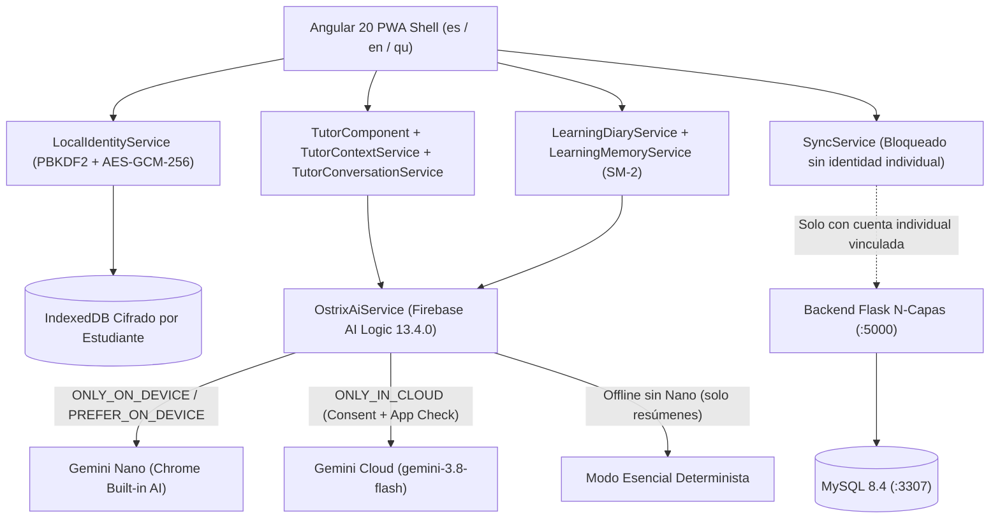

# Arquitectura del Sistema — OstrixAi

Última actualización: 2026-11-18.

## 1. Visión General (Offline-First + IA Híbrida)

## 2. Capas del Frontend (`frontend/ostrixai-web`)
- **Presentación:** `App` (`app.ts`, `app.html`) con navegación por fragmentos `#bienvenida`, `#acceso`, `#registro`, `#perfil`, `#inicio`, `#diario`, `#apuntes`, `#dudas`, `#eureka`, `#repaso`, `#progreso`, `#tutor`, `#libro-<id>`, `#configuracion`; y `TutorComponent` montado dentro del shell principal.
- **Identidad y Cifrado:** `LocalIdentityService` aísla todas las tiendas (`sessions`, `learning_memory`, `reviews`, `tutor`, `settings`, `translations`, `outbox`, `drafts`) por alumno mediante clave AES-GCM derivada de contraseña.
- **Memoria Pedagógica Real:**
  - `LearningDiaryService`: estructura `Fecha → Asignatura → Sesión → Contenido` sin sobrescribir apuntes originales.
  - `LearningMemoryService`: gestiona conceptos (`PENDING → EXPLAINED → TESTED → MASTERED / REINFORCING`), evaluación determinista contra `EXERCISE_CATALOG` y programación SM-2.
  - `TutorContextService`: ensambla un snapshot acotado (máx. 16 KB) y transparente para el estudiante (nunca envía todo el diario automáticamente).
- **Motor Híbrido:** `OstrixAiService` usa `@firebase/ai` (`firebase@13.4.0`), `GoogleAIBackend`, `InferenceMode` (`ONLY_ON_DEVICE`, `PREFER_ON_DEVICE`, `ONLY_IN_CLOUD`), `ThinkingLevel.LOW`, `AbortController`, timeout 45s y verificación directa de `response.inferenceSource`.
- **PWA:** `@angular/service-worker` con `ngsw-config.json` pre-cacheando el app shell, iconos y recursos estáticos, nunca datos privados de estudiantes.

## 3. Capas del Backend (`backend/`)
Arquitectura N-Capas estricta:
- **Controllers:** `diary_controller.py`, `sync_controller.py`, `translation_controller.py` (autenticación Firebase ID Token + App Check, códigos HTTP 400/401/415/503).
- **Services:** `diary_service.py`, `sync_service.py`, `translation_service.py` (validación UUIDv4, límites de tamaño, idempotencia, aislamiento por `uid` del servidor).
- **Repositories:** `diary_repository.py`, `sync_repository.py`, `translation_gateway.py` (transacciones MySQL y gateway Google Cloud Translation).
- **Models & Migrations:** `academic_diary.py`, `sync_event.py`, `migrations/001_initial_schema.sql`, `migrations/002_academic_journal_and_learning_memory.sql`.
